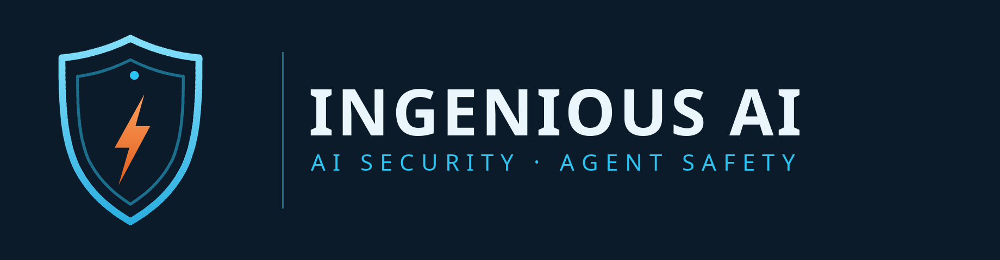

<p align="center">
  <a href="https://getingeniousai.com">
    
  </a>
</p>

# Ingenious AI — Founder-Led Open-Source Security Engineering

I build practical security tools for AI agents, MCP integrations, developer infrastructure and software supply chains.

I'm the founder and technical builder behind [**Ingenious AI**](https://getingeniousai.com/).

My work focuses on turning emerging security problems into small, useful, reproducible tools that developers can actually run — zero-dependency where possible, honest about what a check can and cannot prove.

## What I'm working on

- **AI Agent Security** — Authorization, least privilege, action controls and evidence.
- **MCP Security** — Server provenance, tool permissions, configuration auditing and trust.
- **Software Supply Chain Security** — Package integrity, plugin verification and CI/CD protection.
- **AI Security Testing** — Prompt injection, context boundaries, RAG poisoning and agent behavior.
- **Security Automation** — Lightweight tools, CLI utilities and reusable GitHub Actions.

## Start here

- **[mcp-permission-firewall](https://github.com/Iceman2050/mcp-permission-firewall)** — Audit and harden MCP server configs: least-privilege policies for AI agent tools, before you trust a pasted config.
- **[cve-to-checker](https://github.com/Iceman2050/cve-to-checker)** — Turn vulnerability advisories into reusable "am I affected?" exposure-checker projects.
- **[cve-2026-110447-checker](https://github.com/Iceman2050/cve-2026-110447-checker)** — A focused, passive Nextcloud exposure checker for CVE-2026-110447.
- **[ghostaction-guard-action](https://github.com/Iceman2050/ghostaction-guard-action)** — A free GitHub Action that scans your workflows for GhostAction-style malicious CI injection.
- **[plugin-provenance-verifier](https://github.com/Iceman2050/plugin-provenance-verifier)** — Audit where your Claude Code plugins actually came from — and catch silent drift.
- **[history-tamper-guard](https://github.com/Iceman2050/history-tamper-guard)** — A user-side notary for agent conversation history: hash-chained turns, tamper detection.
- **[api-key-sprawl-mapper](https://github.com/Iceman2050/api-key-sprawl-mapper)** — Maps API-key distribution across repositories without ever printing secret material.
- **[saas-offboarding-checklist](https://github.com/Iceman2050/saas-offboarding-checklist)** — Ordered SaaS access-revocation runbooks for departing employees.

The full open-source estate — every tool, one registry-verified directory:
**[Ingenious AI — All Links](https://ingeniousai-security-checks-mirror-0e97b6.gitlab.io/all-links.html)**

## Run a tool in 60 seconds

Every checker here is a standalone, zero-dependency tool — no platform account, no install beyond Python 3:

```bash
git clone https://github.com/Iceman2050/cve-to-checker
cd cve-to-checker
python3 checker.py --help   # each repo's README carries its own exact commands and sample output
```

## How to read a result

Every Ingenious AI checker reports in the same four verdicts:

- **Confirmed** — the check found direct evidence of the issue.
- **Possible** — signals point to the issue, but the evidence is not conclusive.
- **Not detected** — the check ran and did not find the issue in what it could observe. **Not detected is not the same as safe** — it means this check, on this surface, found nothing.
- **Inconclusive** — the target could not be reached or fully observed, so no verdict is claimed.

Sample output (from a CVE exposure checker):

```text
Target: https://example.com
Check:  CVE-2026-110447 exposure
Result: NOT DETECTED — no exposure signature observed in the responses checked.
        This is not proof the target is safe; it covers only the paths this checker tests.
```

## Limitations & authorized use

- These are passive, defensive checks. A checker verifies only the specific vulnerability, configuration or behaviour named in its README — never the overall security of a system.
- Run them only against systems you own or are explicitly authorized to test.
- Security policy for every repo in this account: see [SECURITY.md via the account defaults](https://github.com/Iceman2050/.github/blob/main/SECURITY.md).

## The hosted platforms

The free tools solve one problem at a time. The Ingenious AI platforms solve the recurring, operational version of the same problems — continuous control, evidence and monitoring:

- **[Agent Auth Gateway](https://authgateway.getingeniousai.com)** — spend caps, allow/deny policies and approval queues for AI agents.
- **[Agent Flight Recorder](https://flightrecorder.getingeniousai.com)** — hash-chained, tamper-evident records of agent actions.
- **[BreachHunter](https://breachhunter.getingeniousai.com)** — automated website security scanning; the free front door.
- **[DomainGuard](https://domainguard.getingeniousai.com)** — lookalike-domain and phishing-impersonation defense.

## Engineering principles

- Prefer simple, understandable implementations.
- Minimize unnecessary dependencies.
- Make security limitations explicit.
- Provide reproducible examples and test results.
- Respect privacy and minimize data collection.
- Document authorized-use requirements.
- Never claim a security check proves more than it actually verifies.

## Get involved

- Website: [https://getingeniousai.com/](https://getingeniousai.com/)
- Portfolio: [https://getingeniousai.com/portfolio](https://getingeniousai.com/portfolio)
- GitHub: [https://github.com/Iceman2050](https://github.com/Iceman2050)
- Company organization: [https://github.com/getingeniousai](https://github.com/getingeniousai)
- Contact: orders@getingeniousai.com

Issues, technical feedback and constructive contributions are welcome.

*Building useful security infrastructure, one practical tool at a time.*
